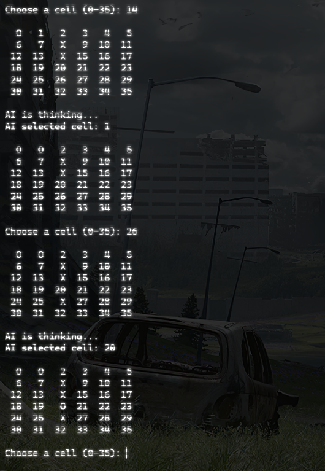

# Przed odpaleniem
- w środku tworzymy venv ```python -m venv .venv```
- wchodzimy w nasze środowisko wirtualne ```.\.venv\Scripts\activate```
- instalujemy zależności ```pip install -r requirements.txt```
- stąd pobieramy source code (na dole jest zip): https://github.com/Zulko/easyAI/releases/tag/easyAI-v2.1.0
- w folderze easyAI jest folder AI, kopiujemy go do .venv/Lib/easyAI
- odpalamy kod: ```python 4X_solver.py```
- Cieszymy się grą


## Screen z gry
